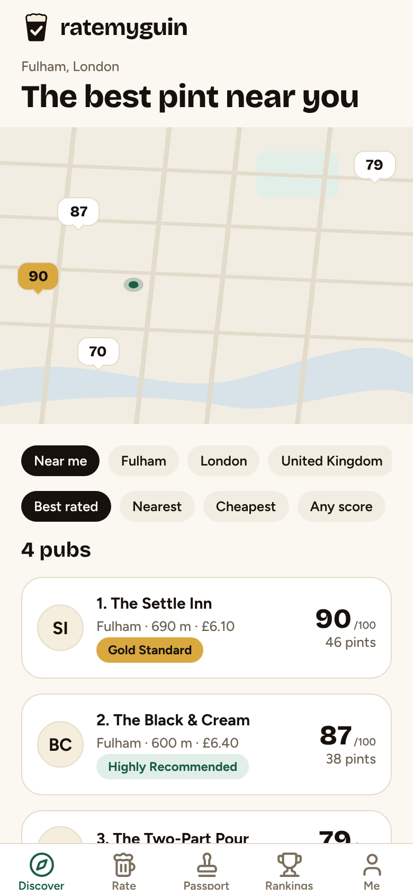
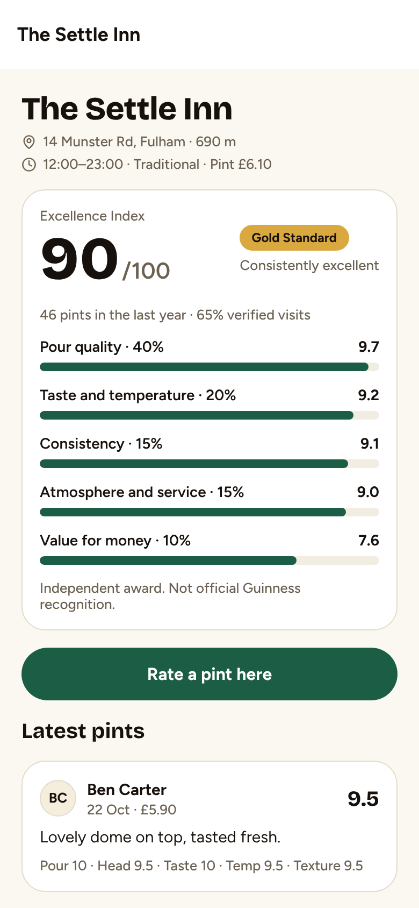
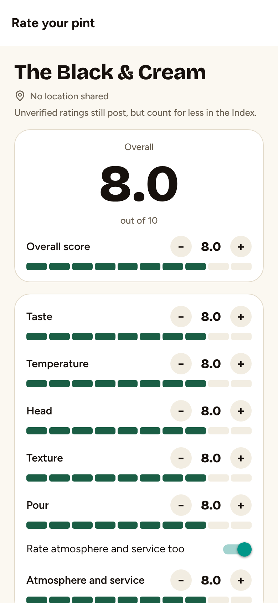
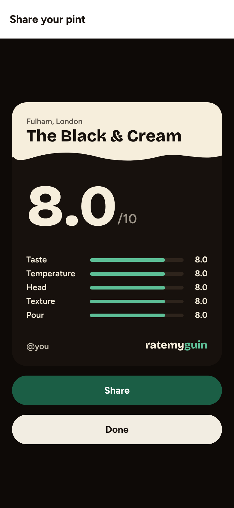
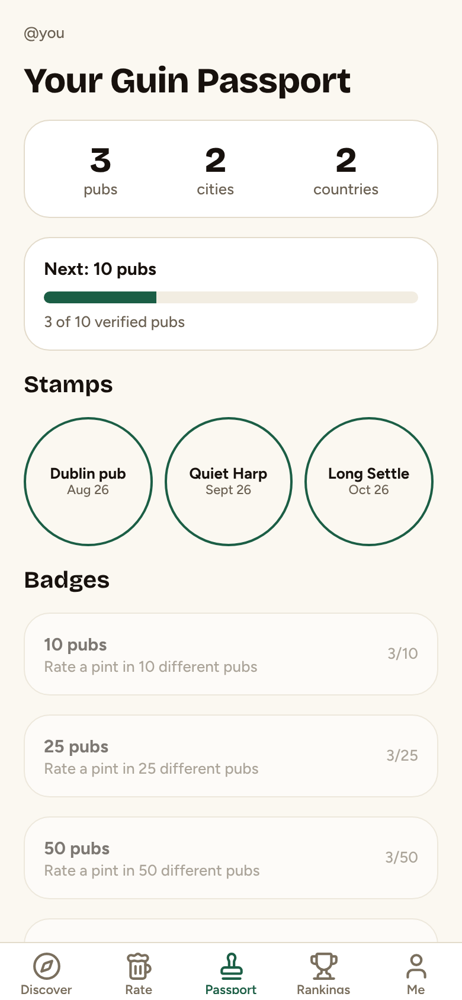
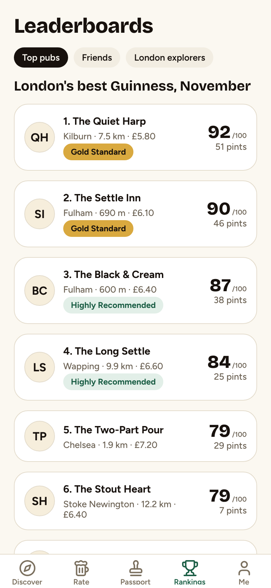
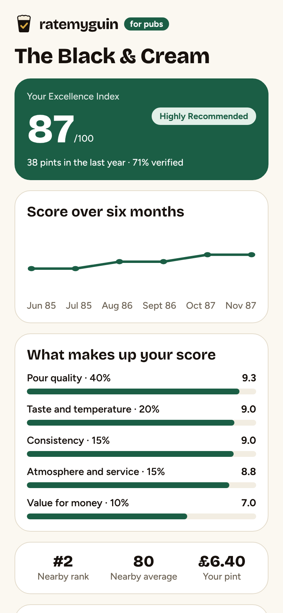

# RateMyGuin

The independent, community-powered platform for discovering, rating and ranking the best pints of Guinness. Untappd meets TripAdvisor, with the competitive streak of Strava. Launching in London.

RateMyGuin is independent and not affiliated with Guinness or Diageo. Its awards are independent recognition, not official Guinness awards.

Plan: [MVP plan](https://claude.ai/artifact/74aLqdiQFh5jXn6crNKwLd) · Brand board: [v0 chat](https://v0.app/chat/mo1e03Gzeju) · logo, award badges and tokens in [`docs/brand/`](docs/brand)

## What's here

| Path | What it is |
| --- | --- |
| `mobile/` | One Expo (React Native) codebase that builds two store apps: **RateMyGuin** for drinkers and **RateMyGuin for Pubs** for pub owners |
| `mobile/src/domain/` | The Excellence Index, verified visits, anti-fraud, credibility weights, Passport badges and leaderboards, as pure functions with tests |
| `supabase/migrations/` | Postgres schema: pubs, ratings, follows, pub claims and replies, row level security, the `pub_scores` view and `pubs_near` |
| `supabase/tests/` | SQL behaviour tests for verification, anti-fraud, credibility, the Index and replies |

## The Excellence Index

Every pub gets a score out of 100 from the last year of ratings:

| Part | Weight | From |
| --- | --- | --- |
| Pour quality | 40% | pour (double), head and texture |
| Taste and temperature | 20% | taste and temperature |
| Consistency | 15% | how much the overall scores swing (a 3-point spread scores 0) |
| Atmosphere and service | 15% | optional atmosphere score |
| Value for money | 10% | median price against the city median |

Each rating is weighted by reviewer credibility (0 to 2): a verified visit counts fully, an unverified one counts 0.4, receipts add 25%, experienced raters count up to 40% more, new accounts are discounted for a month, and pub staff count for nothing. Scores are shrunk towards 70 until a pub has enough ratings, so one keen regular can't top the chart. A pub needs 3 ratings for a score and 10 to win an award: **Exceptional** 95–100, **Gold Standard** 90–94, **Highly Recommended** 80–89.

The weights are a starting point to refine with customer research. They live in `mobile/src/domain/scores.ts` and are mirrored in the `pub_scores` view; change both together.

Anti-fraud: a rating is verified when the phone is within 75 m of the pub with a GPS fix better than 60 m; one rating per pub every 3 hours; at most 12 a day; and a jump faster than 120 km/h from your last rating is refused. The database enforces these whatever the app sends, and sets verification and weight itself.

## Run the apps

Needs Node 22 and the Expo Go app (or a simulator).

```bash
cd mobile
npm install
npm start            # RateMyGuin (drinkers)
npm run start:pubs   # RateMyGuin for Pubs
```

Without Supabase settings the apps run in **demo mode** with eight made-up London pubs and about 240 sample ratings. The pub names are fictional, not real pubs.

## The live backend

The Supabase project is `yhttayboxljswczexspg` (London). The apps use it whenever `EXPO_PUBLIC_SUPABASE_URL` and `EXPO_PUBLIC_SUPABASE_ANON_KEY` are set: test and store builds get them from `mobile/eas.json`, and for local runs copy `mobile/.env.example` to `mobile/.env.local`. Without them the apps run in demo mode. Only the publishable key goes in the app, never the secret key.

Two GitHub Actions workflows look after the database. Both need the repository secrets `SUPABASE_ACCESS_TOKEN` and `SUPABASE_DB_PASSWORD`.

- **Deploy Supabase** runs on every merge that touches `supabase/`. It applies new migrations and sets the sign-in code email.
- **Load pubs from OpenStreetMap** is run by hand from the Actions tab. It adds every named pub in London, Dublin or Manchester and is safe to run again. Pub data © OpenStreetMap contributors.

Sign-in is by email code. Supabase's built-in email sender only allows a few emails an hour, so add your own SMTP provider (Auth → SMTP settings) before inviting testers.

## Checks

```bash
cd mobile && npm run typecheck && npx eslint . && npm test
supabase/tests/run.sh   # needs psql and Postgres with PostGIS (PG* env vars)
```

CI runs both on every pull request.

## Screenshots (demo mode)

| Discover | Pub profile | Rate your pint | Shareable pint card |
| --- | --- | --- | --- |
|  |  |  |  |

| Guin Passport | Rankings | Pubs: dashboard |
| --- | --- | --- |
|  |  |  |

## Not built yet

A real map, photo upload to storage (photos stay on the phone for now), receipt checking, follows and comments in the app, pub claiming, award certificates as PDFs, QR codes, embeddable rankings, challenges and seasonal competitions, and app icons.
